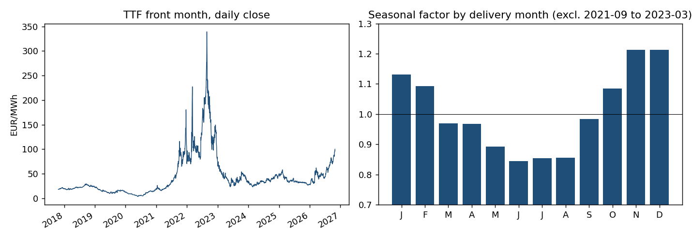
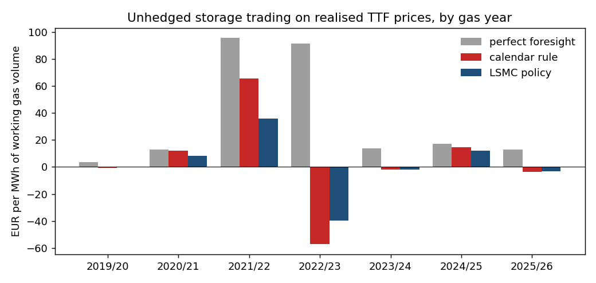
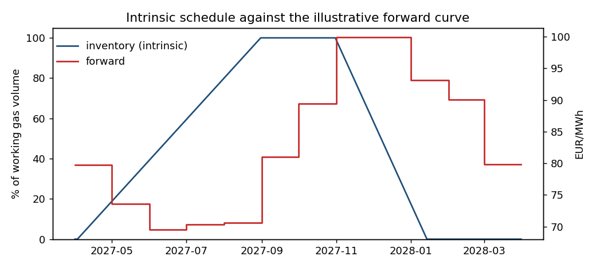
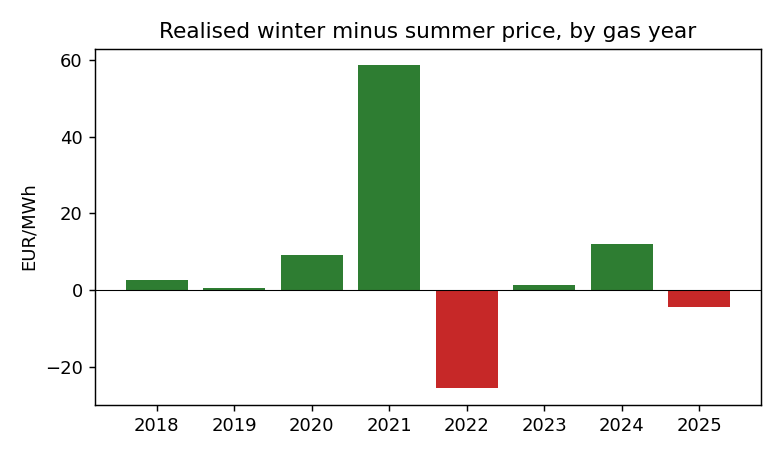

# eu-gas-storage-valuation

What is a seasonal gas storage worth at the Dutch TTF hub, how much of that value is the summer to
winter spread you can lock in today (intrinsic) and how much is the option to react to prices later
(extrinsic)? And what would the storage actually have earned in the gas years 2019/20 to 2025/26,
through the 2021-2022 gas crisis? A research study on open TTF price data with a linear program for
the intrinsic value and least-squares Monte Carlo for the full value.

Related: [de-power-market-ppa](https://github.com/michaelserikov/de-power-market-ppa), where German
power, gas and carbon prices are cointegrated, and
[de-battery-multimarket](https://github.com/michaelserikov/de-battery-multimarket), the same
intrinsic versus flexibility question for a battery.

## Results

Facility: 1 TWh working gas volume, full in 150 days, empty in 75 days, variable costs 0.25 EUR/MWh
injected and 0.10 EUR/MWh withdrawn, empty at the start and end of the storage year. Values are in
EUR per MWh of working gas volume, discounted at 2.5%.

### Value for the storage year April 2027 to March 2028 (valued on 28 October 2026)

The forward curve is illustrative (see Model): the front month on the valuation date (99.90 EUR/MWh)
scaled by a seasonal shape estimated from history, whose depth is varied below. Spot model:
kappa 2.9 per year (half-life 87 days), sigma 0.74, calibrated on April 2023 to October 2026.

| Winter minus summer on the curve (EUR/MWh) | Intrinsic | Total (LSMC) | Extrinsic |
|---|---|---|---|
| 0 (flat curve) | 0.0 | 17.0 | 17.0 |
| 5.1 | 5.9 | 18.7 | 12.9 |
| 9.8 | 12.4 | 21.6 | 9.2 |
| 17.9 (full estimated shape) | 24.1 | 29.1 | 5.0 |

Monte Carlo standard errors are about 0.5 (2,000 paths; 0.26 for the full shape with 8,000).

| Volatility sigma | kappa 1 | kappa 3 | kappa 10 |
|---|---|---|---|
| 0.25 | 0.3 | 0.7 | 1.0 |
| 0.50 | 0.8 | 2.4 | 3.2 |
| 0.75 | 1.8 | 5.2 | 7.0 |
| 1.00 | 3.2 | 8.8 | 11.7 |

Extrinsic value with the full estimated shape, by volatility and mean reversion.

| Facility (days to fill / to empty) | Intrinsic | Total | Extrinsic |
|---|---|---|---|
| Seasonal 150 / 75 | 24.1 | 29.1 | 5.0 |
| Medium 60 / 30 | 28.2 | 36.9 | 8.6 |
| Fast-cycle 20 / 10 | 28.6 | 43.6 | 15.0 |

Findings:

- **Intrinsic and extrinsic value substitute for each other.** A flatter curve removes intrinsic
  value but raises extrinsic value, because the owner keeps the freedom to cycle on price swings
  instead of being committed to one summer to winter trade. Over the range tested the intrinsic
  value falls by 24 EUR/MWh, the total only by 12.
- **The extrinsic value is a volatility and mean-reversion bet.** It ranges from 0.3 to 11.7
  EUR/MWh over plausible parameters. Faster mean reversion raises it: price deviations close within
  the storage year, so buying low and selling high pays more often.
- **Flexibility is worth most as optionality.** The same volume with ten times the injection and
  withdrawal rates gains only 4.5 EUR/MWh of intrinsic value but three times the extrinsic value.

### Backtest: unhedged storage trading in past gas years

On 31 March of each year the curve and the spot model are estimated from earlier data only, the
policy is trained on simulated paths and then executed on the realised TTF path. No futures hedge.

| Gas year | Price 31 March | Curve spread | Perfect foresight | Calendar rule | LSMC policy |
|---|---|---|---|---|---|
| 2019/20 | 14.22 | 0.5 | 3.7 | -0.6 | -0.2 |
| 2020/21 | 6.90 | 1.6 | 13.0 | 12.0 | 8.2 |
| 2021/22 | 19.00 | 7.0 | 95.7 | 65.6 | 36.1 |
| 2022/23 | 125.91 | 45.7 | 91.4 | -57.1 | -39.5 |
| 2023/24 | 47.85 | 17.4 | 13.7 | -2.1 | -1.8 |
| 2024/25 | 27.34 | 10.0 | 17.2 | 14.6 | 11.9 |
| 2025/26 | 40.67 | 13.7 | 12.9 | -3.6 | -3.2 |
| **Sum** | | | **247.6** | **28.8** | **11.5** |

Calendar rule: inject from 1 April until full, withdraw from 1 December until empty.

- **Without a hedge the result is a bet on the price level.** The calendar rule earned 65.6 in
  2021/22, when prices rose through the year, and lost 57.1 in 2022/23, when gas bought at crisis
  prices in summer was sold after the collapse. Four of seven years were losses.
- **The LSMC policy loses less in falling markets and earns less in rising ones.** It beat the
  calendar rule in the four loss years and trailed it in the three profitable ones; summed over the
  seven years it earned 11.5 against 28.8. It reacts to price moves the model treats as temporary,
  which hurts when they persist (2021/22).
- **The value is captured by hedging.** Perfect foresight shows 248 EUR/MWh was available; a storage
  owner secures the spread by selling winter and buying summer futures on day one and then
  re-optimises against the curve. Doing that needs historical forward curves, which are not open
  data (see Next).

The realised winter minus summer spread of the front month was positive in six of the eight
complete gas years from 2018/19 and negative in 2022/23 (-25.7 EUR/MWh) and 2025/26 (-4.3).






## Model

- **Prices:** daily closes of the continuous TTF front-month future (Yahoo Finance, TTF=F, from
  October 2017), used as a spot proxy: on each day it is the price for delivery next month.
- **Seasonal shape:** log price minus a centred one-year rolling mean, averaged by delivery month,
  excluding September 2021 to March 2023. Winter months trade up to 21% above the annual mean,
  June to August about 15% below.
- **Forward curve:** the front month on the valuation date scaled by the seasonal factors. A real
  settlement curve can be supplied as a CSV (`curve.read_curve_csv`).
- **Intrinsic value:** linear program over daily injection and withdrawal against the forward curve
  (SciPy, HiGHS), rate limits, inventory bounds, start and end inventory.
- **Spot model:** one-factor mean-reverting log price around the forward curve (Schwartz 1997),
  E[S(t)] = F(t). kappa and sigma from an AR(1) of the deseasonalised log price on trading days.
- **Full value:** least-squares Monte Carlo (Boogert and de Jong 2008). Inventory on a grid of one
  day of full injection, cubic polynomials in the price as regressors, separate regressions per
  inventory level, decisions restricted to those that can still reach the end inventory. The
  policy is estimated on one set of paths and valued on an independent set, so the reported value
  is a lower bound of the model value up to Monte Carlo error. With zero volatility it reproduces
  the intrinsic value (tested).

## Limitations

- The forward curve is constructed, not observed. The estimated seasonal shape comes from realised
  prices and is deeper than typical traded spreads, which is why the value is reported over the
  spread rather than as one number.
- The front month is not day-ahead gas: it moves less day to day and jumps at contract rolls. One
  price factor only; real curves move in level and in spread separately.
- Constant injection and withdrawal rates (no ratchets that depend on the fill level), no
  capacity cost, no bid-ask spread or market impact, no storage regulation (fill-level targets).
- Illustrative research study on public data; not a commercial valuation.

## Next

- v0.2: fundamentals with GIE AGSI+ storage and ALSI LNG data, ENTSOG flows and ERA5 heating
  degree days: a weather-driven withdrawal model and fill-level trajectories for the winter.
- v0.3: rolling intrinsic and a hedged backtest, fill-dependent ratchets, two-factor spot model.

## Run

```bash
pip install -e ".[test]"
pytest -q                  # offline, synthetic data
python -m gasstor.run      # downloads TTF prices, writes results/ and figures/ (about 10 minutes)
```
